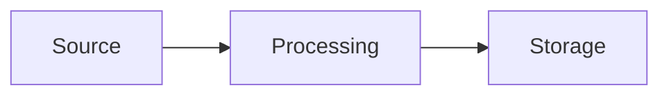

### Related Files:

[[Prerequisite Page]]
[[Related Page]]

---

# System or Domain - Overview

> One or two sentences: what this system is and what it is for.

## Details

| Field | Value |
| --- | --- |
| Owner |  |
| Status | Planned / Active / Being replaced / Retired |
| Last reviewed | DD-MM-YYYY |

## Context

What problem this system solves, and where it sits relative to everything else.

## Components

| Component | Responsibility | Notes |
| --- | --- | --- |
|  |  |  |

## How It Works

The flow, in words, followed by the diagram. Diagrams live in `Diagrams/`.

## Trust Boundaries And Data Flows

Where the boundaries are and what is enforced at each. Detail in `Flows/`.

## Security Controls

| Control | What it protects | Where it is enforced |
| --- | --- | --- |
|  |  |  |

## Key Decisions

Summary of the decisions that shaped this. Detail in `Decisions/`.

| # | Decision | Status |
| --- | --- | --- |
| 0001 | [[0001 - Decision]] | Accepted |

## Known Limitations And Risks

- 

## Open Questions

- 

> Use roles and placeholders, never real account numbers, hostnames or IPs.