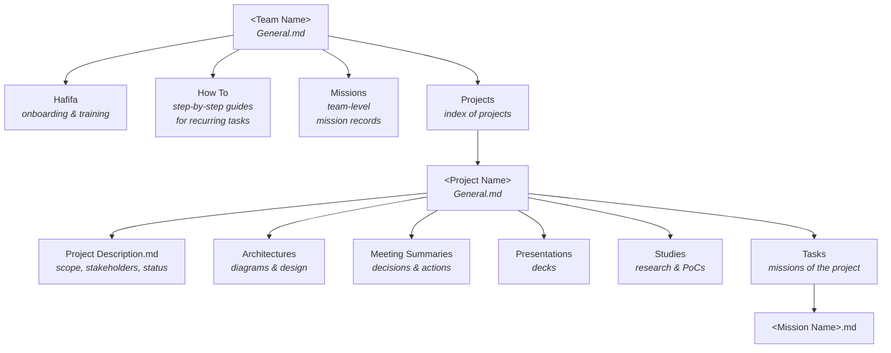

# Cloud Security Wisdom

Welcome to the Cloud Security department knowledge repository.

This repo is our shared, long-term memory. Everything we learn — concepts, tools, team-specific know-how, past missions, investigations of past events and research — lives here so that no knowledge stays in one person's head, chat history, or laptop.

It is an **Obsidian vault**, so you can open the folder directly in Obsidian and get backlinks, graph view and search. It is also plain Markdown, so it reads fine on GitHub or in any editor.

---

## ⚠️ Before you write anything — classification comes first

**This repository is not a place to dump everything you know. Use judgement on every single page you write.**

Before you type a word, and again before you push, ask yourself three questions in this order:

1. **Should this be written down at all?** Some things must not be documented here, regardless of how useful they would be. If writing it down creates risk that outweighs the knowledge gained — don't write it.
2. **Should it be written *here*?** This repo has a defined audience and a defined classification level. Anything above that level belongs in the sharepoint, not here. "It's just internal" is not a classification decision — the classification rules are.
3. **How should it be written?** Most knowledge can be captured safely by generalizing: describe the *technique*, the *pattern* and the *lesson* instead of the specific target, identifier or data. A guide that says "query the audit log for `<account-id>`" teaches exactly as much as one with a real account ID — and leaks nothing.

**Never write here:**

- Credentials of any kind — passwords, tokens, API keys, private keys, connection strings, session cookies.
- Real identifiers that map to real assets: account / subscription / project / tenant IDs, internal hostnames and URLs, IP addresses, ARNs and resource names.
- Customer, partner or personal data, in any form.
- Raw logs, raw exports, raw scan output or raw findings — summarize instead.
- Live, unremediated vulnerabilities described in enough detail to be exploited.
- Anything classified above this repository's approved level, or material you received under a restriction you are not authorized to lift.

**Remember:**

- **Screenshots leak more than text.** A single screenshot can contain a URL, an account ID, an email address, a token in a query string and three browser tabs you forgot about. Crop and redact *before* pasting, never after.
- **Attachments are opaque.** A `.docx`, `.pptx` or `.xlsx` hides its contents from review — metadata, tracked changes, hidden sheets and comments all travel with the file. Check them before committing.
- **Git never forgets.** Deleting a secret in a later commit does not remove it from history. A leak committed once is a leak that must be reported and the credential rotated — not something you can quietly fix.
- **Use placeholders.** `<account-id>`, `<tenant-id>`, `<repo-name>`, `example.internal`. Generalize names, round numbers, remove dates where they identify an event.
- **When in doubt, don't — ask first.** Ask your team lead or the person responsible for classification. An unwritten page costs a conversation; a wrongly written one costs far more.

> You are responsible for what you publish here. The Pull Request has your name on it, and review is a safety net — not a substitute for your own judgement.

---

## The idea behind it

- **Write once, reuse forever.** If you solved something hard, someone else will hit it again.
- **Onboarding by reading.** A new member should be able to get productive by walking this repo top to bottom.
- **Evidence over memory.** Missions and investigations are documented while they are fresh, not reconstructed later.
- **Living documents.** Pages are expected to be edited, corrected and extended. Outdated is worse than missing.

---

## Repository at a glance

```text
Cloud Security Wisdom/
├── 0 - General/                          # Who we are, how we work, onboarding, terminology
├── 1 - Basic Knowledge For Cloud/        # Shared technical foundations
│   ├── CI-CD/
│   ├── Common Cloud Platform Terms/
│   └── GitHub/
├── 2 - Tools & Platforms/                # Operational manuals for the tools we use
├── 3 - Teams Knowledge/                  # Team-owned knowledge (see team structure below)
│   ├── AI Security & Wiz/
│   ├── Application Security/
│   ├── Cloud Security AWS/
│   ├── Cloud Security GCP & Azure/
│   ├── DefenSys/
│   ├── Light Rail/
│   └── Ocean 19/
├── 4 - Missions - Department Level/      # Missions - department scope
│   └── YYYY/ → YYYY-MM-DD - Mission Name/
├── 5 - Reports - Department Level/       # Formal deliverables and reports - department scope
│   └── Assessments|Audits|Post-Mortems|Periodic/ → YYYY/ → YYYY-MM-DD - Report Name/
├── 6 - Studies - Department Level/       # Research, evaluations, PoCs - department scope
│   └── Study Subject/
├── 7 - Presentations - Department Level/ # Decks and knowledge-sharing sessions - department scope
│   └── YYYY/ → YYYY-MM-DD - Topic/
├── 8 - Architectures - Department Level/ # Diagrams, designs, data flows - department scope
│   └── System/Project or Domain/
├── 9 - Meeting Summaries/                # Decisions and action items - department scope
│   └── YYYY/ → YYYY-MM-DD - Subject.md
├── 10 - Extras/                          # Meta: templates and AI tooling
│   ├── Skills For AI/
│   └── Templates/
│       ├── Team Organization of Knowledge - Template/   # how a team folder is laid out
│       ├── Content Folders Structure - Template/        # how the six content folders are laid out
│       └── Document Templates/                          # one skeleton per document type
├── Attachments/                          # All images and attached files (auto-managed)
└── README.md                             # You are here
```

Every folder also contains a `General.md`. More on that below.

The six recurring content folders — **Missions**, **Reports**, **Studies**, **Presentations**, **Architectures** and **Meeting Summaries** — exist at department level, inside every team and inside every project, and they are laid out identically everywhere. See [Content folder layouts](#content-folder-layouts).

---

## Folder guide

### `0 - General`
Department-level information that is not technical: who we are, how we work, team structure, ways of working, terminology we use internally, onboarding checklists, recurring processes and conventions. **Start here on your first day.**

### `1 - Basic Knowledge For Cloud`
The foundations everyone in the department is expected to know. If a concept is assumed in a mission or research note, its explanation should be here.

- `CI-CD` — pipelines, build and deployment concepts, pipeline security, supply-chain basics.
- `Common Cloud Platform Terms` — the shared vocabulary across AWS / Azure / GCP (identity, networking, compute, storage, logging) and how the providers name the same ideas differently.
- `GitHub` — repos, branching, Actions, permissions, secrets, and GitHub-specific security considerations.

### `2 - Tools & Platforms`
One place per tool or platform we actually use: what it does, why we chose it, how to access it, how to run the common tasks, known limitations, gotchas and useful queries. Think "operational manual", not marketing page.

### `3 - Teams Knowledge`
Knowledge owned by a specific team. Each team is responsible for keeping its own folder accurate. Cross-team readers are welcome — this is how we avoid silos.

- `AI Security & Wiz`
- `Application Security`
- `Cloud Security AWS`
- `Cloud Security GCP & Azure`
- `DefenSys`
- `Light Rail`
- `Ocean 19`

Each team folder follows the **standard team skeleton** — see [Team knowledge structure](#team-knowledge-structure) below.

### `4 - Missions - Department Level`
Records of missions and engagements carried out at department scope: goal, scope, timeline, what we did, what we found, what we delivered and what we would do differently.

### `5 - Reports - Department Level`
Formal written outputs we hand to someone else: assessments, audits, reviews, periodic summaries, findings and recommendations — plus the material behind them. This is also where write-ups of past events live: incidents, suspicious findings and post-mortems, with timeline, root cause, impact and lessons learned.

### `6 - Studies - Department Level`
Deeper, exploratory work that is not tied to a single mission: new attack techniques, new services, tool evaluations, proofs of concept and their conclusions. Includes research that ended in a dead end — knowing what *doesn't* work is also knowledge.

### `7 - Presentations - Department Level`
Decks and knowledge-sharing sessions given at department level: mission debriefs, training, internal talks. Always paired with a Markdown page describing the deck.

### `8 - Architectures - Department Level`
How our environments, platforms and security controls fit together: architecture diagrams, data flows, trust boundaries, design decisions and reference architectures.

### `9 - Meeting Summaries`
Meetings whose outcome matters beyond the room: decisions, action items, owners and open questions. One page per meeting, named `YYYY-MM-DD - Subject`.

### `10 - Extras`
Everything *about* the repo rather than knowledge itself: `Templates` (the canonical skeletons — team layout, content folder layouts and one document template per document type) and `Skills For AI` (prompts and instruction files for AI assistants working in this vault and in general).

### `Attachments`
The single vault-wide location for every pasted image and attached file. Managed automatically by Obsidian once configured — see [Attachments](#attachments-images-and-files).

> ### Department level vs. team level
> `Missions`, `Studies`, `Presentations`, `Architectures` and `Meeting Summaries` exist **twice**: once at the repository root (folders `4`-`9`) and once inside each team's folder. The conventions are identical; only the **scope and audience** differ.
>
> - **Department level** — concerns more than one team, or its outcome matters to the whole department.
> - **Team level** — owned and consumed by a single team.
>
> When in doubt, write it at team level and promote it upward later, leaving a link behind.

---

## How to read this repo

1. **New here?** Read `0 - General`, then `1 - Basic Knowledge For Cloud`.
2. **Joining a team?** Read that team's folder under `3 - Teams Knowledge`, starting with its `Hafifa`.
3. **Starting a mission?** Search `4 - Missions - Department Level` and the team `Missions` folders for something similar before you begin.
4. **Facing an unknown tool?** Check `2 - Tools & Platforms` first.
5. **Going deep on a topic?** `6 - Studies - Department Level` is where the rabbit holes are documented.

### `General.md` — the entry point of every folder

**Every folder in this repository contains a `General.md`.** It is the first thing you should read when you open a folder, and the first thing you should update when you add to it.

A `General.md` explains:

- **Related files** — links to the important pages inside and nearby, placed right after the properties so you can jump straight to them.
- **What this folder is for** — its purpose, in plain words.
- **Why it exists** — what gap it fills, and how it differs from similar folders elsewhere.
- **What it contains** — the kinds of documents that belong here (and what does *not* belong here).
- **A table of contents** — every file and sub-folder in it, each with a one-line description (see below).
- **How to use it** — conventions specific to this folder, naming rules, scope boundaries.
- **General knowledge for the reader** — context, caveats and anything useful that doesn't yet deserve its own page.

It is an index and an orientation page, not a dumping ground. If a section of it grows large, promote it to its own page and link to it.

#### The `Contents` table

Every `General.md` contains a `## Contents` section: a map of the folder, so a reader can see what is inside and decide what to open **without clicking through every file**.

```markdown
## Contents

A short map of everything in this folder, so you can find what you need without opening each file.

| Item | Type | What it is about |
| --- | --- | --- |
| **[[Missions/General\|Missions]]** | Folder | Mission records owned here. |
| [[How To - Create an IAM Policy]] | Note | Creating a least-privilege IAM policy, step by step. |
| [[Access Review 2026.pdf]] | PDF | The signed access review report delivered in November. |
```

Rules:

- **One line per item.** Sub-folders link to their own `General.md`; pages link directly.
- **List sub-folders first**, then files, each group alphabetically.
- **One sentence per item** — what it is about, not what it contains in detail. The point is to help someone choose.
- **Update it in the same Pull Request** that adds, renames or removes a file. A stale index is worse than no index, because people trust it.
- Reviewers should reject a PR that adds a page without listing it in the folder's `Contents`.

> With the **Dataview** plugin you can generate part of this automatically, but a generated list has no descriptions. The one-sentence explanation is the whole value — write it by hand.

Tip: use full-text search (`Ctrl+Shift+F` in Obsidian / the search bar in GitHub) before browsing. The fastest path to an answer is usually a keyword.

---

## Initial setup

### 1. Clone the repo

```bash
git clone <repo-url> "Cloud Security Wisdom"
```

Keep it somewhere you'll actually sync it (and `git pull` regularly — the repo changes).

### 2. Install Obsidian

Download [Obsidian](https://obsidian.md), choose **Open folder as vault**, and point it at the cloned folder. The `.obsidian` folder is committed, so you'll get the vault's shared configuration automatically.

Worth knowing from day one:

- `Ctrl+O` — quick switcher (jump to any page by name).
- `Ctrl+Shift+F` — full-text search across the whole vault.
- `Ctrl+G` — graph view, to see how topics connect.
- `[[Page Name]]` — internal link; `Ctrl+Click` a link to open in a new pane.

### 3. Useful Obsidian plugins

Install from **Settings → Community plugins → Browse**. None are mandatory, but these make the vault much more usable:

| Plugin | Why |
| --- | --- |
| **Excalidraw** | Hand-drawn style diagrams — architectures, attack paths, network flows. Saves as a file in the vault. |
| **ObDrawIO (draw.io)** | Full draw.io editor inside Obsidian, for proper cloud architecture diagrams. |
| **Mermaid / native code blocks** | Diagrams-as-text (`mermaid` code blocks work out of the box) — best for diagrams that should live in version control and be diff-able. |
| **Advanced Slides** | Turn a Markdown page into a presentation — useful for mission debriefs and knowledge sharing sessions. |
| **Dataview** | Query pages like a database — auto-generated indexes and tables (e.g. "all missions from 2026"). |
| **Templater** | Page templates, so every mission / research / investigation record starts with the same structure. |
| **Obsidian Git** | Commit, branch and pull from inside Obsidian if you'd rather not use a terminal. |
| **Admonition / Callouts** | Warning, note and tip boxes for things like "⚠️ outdated" or "unverified". |
| **Paste image rename / Image converter** | Keeps pasted screenshots tidy instead of `Pasted image 20260311.png`. |

> Prefer **diagrams-as-text (Mermaid)** for anything that will be reviewed in a PR — binary or JSON-blob diagrams can't be diffed meaningfully.

**For Office, Google and other non-Markdown files**

Obsidian natively previews images, PDFs, audio and video. For everything else, these plugins let you read and convert files without leaving the vault:

| Plugin | Why |
| --- | --- |
| **Office/Excel/Word Viewer** (`vscode-editor` / `office-viewer`) | Preview `.docx`, `.xlsx` and `.csv` directly inside Obsidian instead of launching Office. |
| **Markdown Table Editor / Advanced Tables** | Edit Markdown tables comfortably — the main reason people reach for a spreadsheet in the first place. |
| **Dataview** | Render a committed `.csv` as a live, sortable table inside a note (`dataview` + `csv` source). Keeps data as text, presents it as a spreadsheet. |
| **Importer** (official Obsidian plugin) | Bulk-import notes and documents from other tools into Markdown — use it when migrating existing material into the repo. |
| **Pandoc Plugin** | Convert a note to `.docx`, `.pptx` or PDF when you need to hand a deliverable to someone outside the repo (requires Pandoc installed). |
| **Advanced Slides** | Write the deck as Markdown and present it from Obsidian, instead of producing a `.pptx` nobody can search. |
| **Open With / Shell commands** | Open an attachment in its native application (Word, Excel, draw.io) with one click from the note. |
| **PDF++** | Annotate and link into specific pages of a PDF — useful for reports and external material. |
| **Link Embed / Auto Link Title** | Turns a pasted Google Drive / Docs URL into a titled, readable link instead of a bare URL. |

> These plugins make non-Markdown files **readable**. They do not make them **knowledge** — the rules in [Office, Google and other non-Markdown files](#office-google-and-other-non-markdown-files) still apply: every binary needs an accompanying Markdown page.

### 4. Configure the Attachments folder (required)

Do this once, before you paste your first screenshot:

**Settings → Files and links → Default location for new attachments → _In the folder specified below_ → `Attachments`**

While you're there, enable **Automatically update internal links** so that renaming or moving a page fixes its links instead of breaking them.

### 5. Use VS Code / your IDE too

Obsidian is great for reading and writing; an IDE is better for everything else:

- Bulk operations — renaming, moving, find-and-replace across many files.
- Reviewing diffs, resolving conflicts, and managing branches and PRs (GitHub Pull Requests extension).
- Markdown linting and consistent formatting.
- **AI assistance** — use Copilot / your AI assistant to draft a page from rough notes, restructure a messy document, generate a Mermaid diagram from a description, summarize a long investigation, or check a page for leaked secrets before you push.

Both tools operate on the same plain Markdown files, so you can switch between them freely — just don't have an unsaved edit open in one while editing the same file in the other.

> AI is a drafting aid, not a source of truth. Anything it writes about our environment, tools or missions must be verified by you before it is committed. You are the author, and you own what's in the PR.

---

## How to contribute

- Add knowledge in the folder where **a reader would look for it**, not where you happened to find it.
- **Exercise judgement first** — decide whether the knowledge should be written at all, whether it belongs in this repo, and how to phrase it safely. See [Before you write anything](#️-before-you-write-anything--classification-comes-first).
- Prefer a new file per topic, with a clear, descriptive name.
- Start each page with one or two sentences explaining what it is and who it's for.
- Link to related pages instead of copy-pasting content.
- **Never commit secrets**: no credentials, tokens, keys, customer data or raw sensitive logs. Redact before you write.
- Fix what's wrong when you spot it. You don't need permission to improve a page.

---

## The contribution workflow (required)

**`main` is protected. Nobody commits directly to `main` — ever. No force pushes, no exceptions.**
Every change, from a full research page to a one-word typo fix, goes through a branch and a Pull Request.

### 1. Sync before you start

```bash
git checkout main
git pull
```

### 2. Create a branch with a meaningful name

The branch name should tell a reviewer what the change is about without opening it.

```bash
git checkout -b add/aws-scp-guardrails
```

Use the prefix that matches your intent:

| Prefix    | Use for                                          | Example                               |
| --------- | ------------------------------------------------ | ------------------------------------- |
| `add/`    | New knowledge, new page, new folder              | `add/wiz-query-cheatsheet`            |
| `update/` | Extending or correcting an existing page         | `update/github-actions-oidc-section`  |
| `fix/`    | Typos, broken links, formatting, wrong facts     | `fix/broken-links-tools-platforms`    |
| `remove/` | Deleting or archiving outdated content           | `remove/deprecated-legacy-scanner`    |
| `mission/`| A past-mission or investigation record           | `mission/2026-03-prod-iam-exposure`   |

Bad: `my-branch`, `update1`, `tmp`, `moshe-stuff`.

### 3. Write the change

Keep one branch focused on one subject. Don't mix a new research page with a folder-wide rename — it makes review impossible.

### 4. Commit in readable chunks

```bash
git add "5 - Researches/AWS SCP Guardrails.md"
git commit -m "add: AWS SCP guardrails research and test results"
git push -u origin add/aws-scp-guardrails
```

Commit messages: short imperative line, prefixed the same way as the branch (`add:`, `update:`, `fix:`, `remove:`).

### 5. Open a Pull Request to `main`

The PR description should answer:

- **What** was added/changed/removed.
- **Why** — what gap it fills, or why the old content is wrong/outdated.
- **Where** it lives and why that folder.
- **Sources** — links, tickets, mission references (redacted as needed).

### 6. Review

- (Optional) Its is recommended that at least **one reviewer** approve before merge.
- For team-owned pages under `3 - Teams Knowledge`, the reviewer should be **from that team**.
- Reviewers check: accuracy, correct location, no secrets, readable, links work.
- Address comments by pushing more commits to the same branch — don't open a new PR.
- Merge into `main` once approved, then delete the branch.

---

## Conventions

**Files and folders**

- One topic per file. If a page grows past "I can't find anything in here", split it.
- File names in `Title Case With Spaces.md` — they are read by humans, not imported by code.
- Name by content, not by author or date: `Azure Managed Identity Abuse.md`, not `Dan's notes 12-03.md`.
- Creating a new folder means creating a new category — only do it when several pages will live there, and add its `General.md` index.
- Every folder has a `General.md` with a `Contents` table. When you add, rename or remove a page, update that table in the same Pull Request.

**Page structure**

Every page follows the same order:

1. **Properties block** (see [Document properties](#document-properties-required)) — no exceptions.
2. **`### Related Files:`** — prerequisites and neighboring pages, so the reader can go read them first.
3. `---`
4. The content: `#` page title, a one-to-two sentence summary of what this is and who it's for, then the body under `##` headings.

Other rules:

- Reserve `#` for the page title; everything else is `##` or deeper.
- Fenced code blocks with a language tag for commands, queries and configs. (e.g. use this at beginning and end of code block ```)
- Add a `References` section at the end for external sources you used — internal pages belong in `Related Files` at the top.
- Mission and Reports records should cover: context, scope, timeline, findings, impact, what we did, lessons learned.

**Writing style**

- **Write what is safe to write.** Generalize: the technique, the pattern and the lesson, not the specific target or identifier. Use placeholders like `<account-id>`.
- Write for the person who knows nothing about this specific thing — including future you.
- Be concrete. Commands, queries and screenshots-in-words beat vague descriptions.
- Date anything that will age: "As of 2026-11, the API does X."
- Mark unverified claims explicitly (`> Unverified:`), so no one treats a guess as fact.

**Linking**

- Prefer linking to an existing page over duplicating its content. Duplicates drift apart and one of them becomes a lie.
- Fix broken links when you find them — in a `fix/` branch.

---

## Document properties (required)

**Every Markdown file in this repository must start with a properties block** (YAML frontmatter) and **right after add a `Related Files` section.** Properties are what make the vault searchable, filterable and queryable — without them a page is just a file someone happened to write.

In Obsidian these appear as the "Properties" panel at the top of the note; in Git they are plain text and fully diff-able.

```markdown
---
title: File appropriate title
aliases:
  - Other related names or topics of the file
tags:
  - types of knowledge detailed in this file
author: Israel Israeli / iisraeli / I.I.
owner: Team/Actor responsible to keep the file updated if needed
created: DD-MM-YYYY
type: What type of document is it
related Teams: teams that are related to this document
needed previous knowledge: knowledge needed to understand this file
---

### Related Files:
documents or resources that might be related or relevant to this file
[[ ]]
```

### The properties

| Property | Required | What to put in it |
| --- | --- | --- |
| `title` | Yes | The real, human title of the document — not the file name if they differ. |
| `aliases` | Yes | Other names, acronyms or topics someone might search for. This is how people find your page when they guess a different word than you used. |
| `tags` | Yes | The *types of knowledge* in the file (`mission`, `research`, `aws`, `iam`, `ci-cd`, `incident`...). Lowercase, hyphenated, reused — not invented per page. |
| `created` | Yes | `DD-MM-YYYY`, the date the document was created. |
| `author` | Yes | Who wrote it — the person to ask when something is unclear. See [How to write your name](#how-to-write-your-name) for the accepted formats. |
| `owner` | Yes | Who is responsible for keeping it accurate (often a team, not a person). |
| `type` | Yes | What kind of document it is: `Note`, `Doc`, `Mission`, `Research`, `Study`, `Report`, `Presentation`, `Architecture`, `Meeting Summary`, `Folder Overview (General)`, `Template`. |
| `related Teams` | Optional | Teams this document concerns, beyond the owning one. |
| `needed previous knowledge` | Optional | Prerequisites — ideally as links: `[[Common Cloud Platform Terms]]`. Saves the reader from reading three paragraphs before realizing they're lost. |

### How to write your name

The `author` field exists so a reader knows who to ask — not to publish your identity. You do not have to write your full name. Pick whichever of these you are comfortable with:

| Format | Example | When to use it |
| --- | --- | --- |
| Full name | `Israel Israeli` | The default, when you don't mind being named. |
| Username | `iisraeli` | The part of your organizational mail between the `xd.` and the `@`. Unambiguous internally, meaningless outside. |
| Initials | `I.I.` | The first letter of your first name and of your last name. Use when even the username is more than you want to publish. |

Rules:

- **Be consistent.** Use the same form everywhere, so your pages can be found together and people learn to recognize you.
- **Never write the full mail address** — the username alone is enough, and a full address is an identifier that does not belong in the repo.
- The same formats apply to `owner` when the owner is a person; when it is a team, write the team name.

### Additional properties worth using

| Property | When to use it |
| --- | --- |
| `updated` | `DD-MM-YYYY` of the last meaningful change. Pairs with `created` to show whether a page is still alive. |
| `status` | `draft` / `in-review` / `active` / `outdated` / `archived`. |
| `scope` | `department` / `team` / `project` — makes the department-vs-team distinction explicit. |
| `project` | The project this document belongs to, if any. |
| `sensitivity` | `public` / `internal` / `restricted`. Forces you to think before writing *and* before sharing. |
| `sources` | Links, tickets or references the content is based on. |
| `review by` | `DD-MM-YYYY` — a date to re-check content that is known to age quickly. |

> With the **Dataview** plugin these properties become queryable: "every `type: Mission` from 2026", "everything tagged `aws` with `status: outdated`". That only works if everyone fills them in honestly.

### Related Files

The `Related Files` section sits **immediately after the properties block, at the top of the page** — before the content, not at the end. That is deliberate: a reader who lands on a page should see the prerequisites and neighbouring pages *before* reading, so they can go read those first if they need to.

```markdown
---
title: ...
...
---

### Related Files:

[[Some Related Page]]
[[Another Relevant Page]]

---

# Page Title

The actual content starts here.
```

- Use Obsidian wiki-links (`[[Page Name]]`). Links are what turn a folder of files into a knowledge base — the graph view and backlinks panel only work if you link.
- Put **prerequisites first**, then neighbouring and follow-up pages.
- If there is genuinely nothing related yet, leave the empty `[[ ]]` placeholder — it reminds the next person to fill it in.
- Separate the section from the content with a `---` rule, so it reads as navigation rather than as part of the page.

---

## Team knowledge structure

Every team organizes its knowledge **exactly the same way**. The canonical skeleton lives in:

`10 - Extras/Templates/Team Organization of Knowledge - Tempalte`

Copy it when you create a new team folder, and copy `Projects/Project Name` when you start a new project. Do not invent your own layout — the whole point is that someone from another team can open your folder and immediately know where to look.

### The hierarchy, step by step

```text
<Team Name>/
├── General.md                      # What this team is and does — read first
├── Hafifa/
│   └── General.md                  # The team's onboarding & training track
├── How To/
│   └── General.md                  # Step-by-step guides for recurring tasks
├── Missions/                       # Team-level mission records
│   └── YYYY/ → YYYY-MM-DD - Mission Name/
└── Projects/
    ├── General.md                  # Index of the team's projects
    └── <Project Name>/
        ├── General.md              # Index of this project
        ├── Project Description.md  # What it is, why, scope, stakeholders, status
        ├── Architectures/          # → System or Domain/
        ├── Meeting Summaries/      # → YYYY/ → YYYY-MM-DD - Subject.md
        ├── Presentations/          # → YYYY/ → YYYY-MM-DD - Topic/
        ├── Studies/                # → Study Subject/
        └── Tasks/                  # The individual missions that make up the project
            └── <Mission Name>.md
```

The inner layout of `Missions`, `Architectures`, `Meeting Summaries`, `Presentations` and `Studies` is the same everywhere — see [Content folder layouts](#content-folder-layouts).



### What each level means

1. **`<Team Name>/`** — the team's root. Its `General.md` describes the team: responsibilities, environments, contacts, routines. Anything team-wide that is not a mission or a project lives here.
2. **`Hafifa/`** — the onboarding track. The ordered path from "just joined" to "can take a mission": required reading, labs, access setup and checkpoints. Whoever finishes Hafifa should be the one to **improve it**.
3. **`How To/`** — the team's practical guides: *how do I actually do X?* One page per recurring task (create a policy, add a firewall rule, onboard an account, grant access), with prerequisites, exact steps, verification, rollback and common errors. New members use it to do real work in their first week; veterans use it to remember the steps of something they last did months ago. Procedure only — the "why" belongs elsewhere.
4. **`Missions/`** — standalone missions owned by the team. One page per mission: context, scope, timeline, what we did, findings, impact, deliverables, lessons learned. A mission that belongs to a project goes in that project's `Tasks/` instead. Formal write-ups and post-mortems that come out of a mission belong in `5 - Reports - Department Level` and should be **linked as related document**.
5. **`Projects/`** — long-lived work with its own scope, stakeholders and deliverables. The folder itself is just an index; each project gets its own sub-folder.
6. **`<Project Name>/`** — one project, self-contained. A newcomer should understand the project end to end from this folder alone. Its content folders follow the layouts in [Content folder layouts](#content-folder-layouts).
   - **`Project Description.md`** — the charter: background, goals, scope, stakeholders, status, deliverables, risks, lessons learned. Always the first file to read.
   - **`Architectures/`** — how the project's systems fit together: diagrams, data flows, trust boundaries, design decisions. Organized by subject.
   - **`Meeting Summaries/`** — one page per meeting (`YYYY-MM-DD - Subject`): decisions, action items, owners. Organized by year.
   - **`Presentations/`** — decks given about the project, each with a Markdown summary page. Organized by year.
   - **`Studies/`** — research, evaluations and PoCs done to make project decisions, including rejected options. Organized by subject.
   - **`Tasks/`** — the individual missions and work items. One page each: goal, scope, owner, status, what was done, findings, outcome.

> **Same names, different levels.** `Missions`, `Studies`, `Presentations`, `Architectures` and `Meeting Summaries` appear both at the repository root (department level, folders `4`-`9`) and inside teams and projects. The format and conventions are identical — what changes is **who owns it and who it is for**. Always ask: does this concern the whole department, one team, or one project? Then file it at that level and link across if needed.

---

## Content folder layouts

Six folders recur throughout the repository: **Missions**, **Reports**, **Studies**, **Presentations**, **Architectures** and **Meeting Summaries**. Each one is laid out the same way everywhere it appears — at department level, inside a team, inside a project.

The skeletons live in `10 - Extras/Templates/Content Folders Structure - Template`. **Copy them. Do not invent a layout.**

### The two organizing principles

| Principle | Used by | Why |
| --- | --- | --- |
| **By date** — `YYYY/` then `YYYY-MM-DD - Name` | Missions, Reports, Presentations, Meeting Summaries | These are *events*. They happened once, on a date, and are not rewritten afterwards. Chronology is how people look for them. |
| **By subject** — `<Subject>/` | Studies, Architectures | These are *living*. They get revisited, extended and superseded. A date in the path would be a lie within a year. |

**One item = one folder when it has attachments, one file when it does not.** A mission with screenshots and exports gets a folder; a two-paragraph meeting summary is just a file. Start as a file, promote to a folder when it grows.

### Missions

```text
Missions/
├── General.md
└── YYYY/
    ├── General.md
    ├── YYYY-MM-DD - Mission Name/
    │   ├── Mission.md          # the record itself — start here
    │   ├── Findings/           # one page per finding
    │   ├── Evidence/           # sanitized queries, outputs, screenshots
    │   └── Deliverables/       # what was handed over
    └── YYYY-MM-DD - Small Mission.md
```

- Mission folder: `YYYY-MM-DD - Mission Name`, dated when the mission **started**. The record inside is always `Mission.md`.
- `Evidence/` holds **sanitized** material only: summarized outputs, redacted screenshots, queries with placeholders. Never raw logs or exports.
- A mission belonging to a project goes in that project's `Tasks/` instead.

### Reports

```text
Reports/
├── General.md
├── Assessments/          # reviews we were asked to perform
├── Audits/               # formal, often externally driven
├── Post-Mortems/         # write-ups of events: incidents, suspicious findings
└── Periodic/             # recurring status and summary reports
    ├── General.md
    └── YYYY/
        ├── General.md
        └── YYYY-MM-DD - Report Name/
            ├── Report.md        # the report itself — start here
            ├── Findings/        # one page per finding
            └── Source Material/ # sanitized data the report is based on
```

- **Kind before year**, because people look for "the last access-review assessment", not "everything from March".
- Report folder: `YYYY-MM-DD - Report Name`, dated when it was **delivered**. The page inside is always `Report.md`.
- A report is the *conclusion*; the work behind it usually lives in `Missions` or `Studies`. Link both ways.

### Studies

```text
Studies/
├── General.md
└── Study Subject/
    ├── Study.md         # question, method, conclusion — start here
    ├── Experiments/     # what was actually tried, and what happened
    └── References/      # external sources, papers, vendor docs
```

- Named by **subject in plain words** — `Cross-Account Role Chaining`, not `Study 3`. No dates in the path.
- Document the **method**, not just the conclusion. A study nobody can reproduce is an opinion.
- **Dead ends belong here too** — knowing what doesn't work saves the next person a week.

### Presentations

```text
Presentations/
├── General.md
└── YYYY/
    ├── General.md
    └── YYYY-MM-DD - Topic/
        ├── Presentation.md  # topic, audience, takeaways — start here
        ├── Deck/            # the deck: .pptx / .pdf / Markdown slides
        └── Demo/            # demo scripts, commands, recordings
```

- `Presentation.md` carries the takeaways **in text**, so the session is searchable. The deck is an attachment, not the knowledge.
- Store a PDF export next to the source deck so it previews inside Obsidian.
- Check the deck for speaker notes, hidden slides and metadata before committing it.

### Architectures

```text
Architectures/
├── General.md
└── System or Domain/
    ├── Overview.md     # what it is, how it fits together — start here
    ├── Diagrams/       # Mermaid, Excalidraw, draw.io
    ├── Decisions/      # one page per decision (ADR), numbered
    └── Flows/          # data flows and trust boundaries
```

- Named by **subject** — `Central Logging`, `Landing Zone`. Architectures are living documents; track change through `updated` and through `Decisions/`.
- Decision records are numbered (`0003 - Centralize Logs In One Account.md`) and **never rewritten** — a new record supersedes an old one. Record the options you rejected and why.
- Prefer **Mermaid**; every diagram needs a sentence saying what to take away from it. Never draw real account numbers, hostnames or IPs.

### Meeting Summaries

```text
Meeting Summaries/
├── General.md
└── YYYY/
    ├── General.md
    ├── YYYY-MM-DD - Subject.md
    └── Recurring Series Name/
        ├── General.md
        └── YYYY-MM-DD - Subject.md
```

- One page per meeting, `YYYY-MM-DD - Subject`. The date sorts the folder; the subject tells people what it was.
- A meeting that repeats gets a series folder; a one-off sits directly in the year folder.
- Write **decisions, not transcripts**. Every action item needs an owner and a date.

### Document templates

Every document type has a ready-to-copy skeleton in `10 - Extras/Templates/Document Templates`:

| Template | For |
| --- | --- |
| `Mission.md` | A mission record |
| `Finding.md` | One finding from a mission or report |
| `Report.md` | A formal deliverable |
| `Post-Mortem.md` | A write-up of an event |
| `Study.md` | Exploratory research |
| `Experiment.md` | One trial inside a study |
| `Presentation.md` | A talk, with its takeaways in text |
| `Architecture Overview.md` | A system or domain |
| `Decision Record.md` | One architectural decision (ADR) |
| `Meeting Summary.md` | A meeting |

Copy the file, rename it to the folder's naming rule, fill in the properties and `Related Files` first, then write. With the **Templater** plugin you can insert them straight from the command palette.

---

## Attachments, images and files

All images and attachments live in the root **`Attachments`** folder, automatically.

**Set it up once:** `Settings → Files and links → Default location for new attachments → In the folder specified below → Attachments`.

**How it works:** when you paste a screenshot (`Ctrl+V`) or drag a file into a note, Obsidian saves it into `Attachments/` and inserts an embed link into your page:

```markdown
![[my-diagram.png]]
![[Cloud Access Review 2026.pdf]]
```

You never navigate to that folder manually — you paste, and the link is created for you. Because every attachment is in one place, moving or renaming a note never breaks its images.

**Rules:**

- **Rename after pasting.** `Pasted image 20261111.png` tells no one anything. Use `aws-org-scp-flow.png`.
- **Redact first.** Screenshots leak far more than people expect: URLs, account IDs, emails, tokens, customer names. Crop and blur before pasting, not after.
- **Prefer text over images** for anything that could be text — commands, configs, logs and Mermaid diagrams are searchable; a screenshot is not.
- **Clean up orphans.** Deleting a page does not delete its attachments.

---

## Office, Google and other non-Markdown files

Markdown is the default. Everything we can write as Markdown, we write as Markdown — it is searchable, linkable, diff-able and reviewable in a Pull Request. A `.docx` or `.pptx` is an opaque blob to Git: nobody can review a change to it, and nobody can search inside it from Obsidian.

But some things genuinely are Office or Google files — a formal report that must be handed over, a deck presented to management, a spreadsheet of findings. Those are welcome, under rules:

> ⚠️ **Classification applies doubly to attached files.** A binary hides its contents from review: metadata, author names, tracked changes, hidden rows and sheets, speaker notes and comments all travel with the file. Open it, inspect it and strip what shouldn't be here **before** you commit it. See [Before you write anything](#️-before-you-write-anything--classification-comes-first).

**The rule: every non-Markdown file is accompanied by a Markdown page.**

The Markdown page is the real knowledge entry — it has the properties block, it is searchable, it shows up in the graph — and it links to the attachment. It should state what the file is, who produced it, when, for whom, and summarize the content so a reader knows whether they need to open the file at all.

```markdown
---
title: Cloud Access Review 2026 - Report
aliases:
  - Access Review Report
tags:
  - report
  - iam
  - access-review
author: Israel Israeli
owner: Cloud Security AWS
created: 11-11-2026
type: Report
---

### Related Files:

[[Access Review Process]]

---

Formal access review report delivered to the platform group on 11-11-2026.

## Summary
Key findings, in text, so this page is searchable.

## The document
![[Cloud Access Review 2026.pdf]]
[[Cloud Access Review 2026.docx]]
```

**Per format:**

| Format | What to do |
| --- | --- |
| **Word (`.docx`) / Google Docs** | Prefer rewriting as Markdown. If the document is a formal deliverable, store the file in `Attachments` **plus a PDF export** (PDFs preview inside Obsidian), with a Markdown summary page. |
| **PowerPoint (`.pptx`) / Google Slides** | Store the deck **and a PDF export**, with a Markdown page listing topic, audience, date, presenter and key takeaways. For internal knowledge-sharing, consider writing the deck in Markdown with the **Advanced Slides** plugin instead. |
| **Excel (`.xlsx`) / Google Sheets** | If the data is small and stable, put it in a **Markdown table** — then it is searchable and diff-able. If it is large or genuinely a spreadsheet (formulas, pivots), store the file and export a `.csv` next to it. |
| **CSV** | Preferred tabular format for anything machine-readable: plain text, diffs cleanly, readable everywhere. Keep CSVs small and committed; link them from a Markdown page that explains the columns. |
| **PDF** | Good for frozen, final deliverables and external material. Always link it from a Markdown page with a summary. |
| **Google Drive links** | A link is not knowledge: access expires, files move, people leave. If the content matters, **export it into the repo**. If you must link, also write a Markdown page summarizing the content so the knowledge survives the link. |
| **Diagram sources** | Prefer Mermaid in a code block. Use Excalidraw / draw.io files when the diagram is too complex for text, and always add a written explanation next to the diagram. |
| **Archives, binaries, installers** | Do not commit them. Reference where they come from instead. |

**Also:**

- See [Useful Obsidian plugins](#3-useful-obsidian-plugins) for plugins that let you preview `.docx` / `.xlsx` / `.csv`, render CSVs as tables, and export notes to Office formats without leaving the vault.
- Keep files small. Git stores every version of a binary forever — a 50 MB deck updated ten times is 500 MB in the repo.
- Never commit anything containing credentials, raw sensitive exports or customer data, regardless of format.
- Name files like you name pages: descriptive and human-readable.

---

## Changing and removing knowledge safely

Content here is referenced by other pages and by people. Deleting is a destructive act — treat it that way.

- **Correcting a fact:** edit in place, and note what changed if it's significant (`update:` commit explains it).
- **Outdated but historically useful:** don't delete. Mark it at the top — `> ⚠️ Outdated as of 2026-11. See [New Page](...)` — and link forward to the replacement.
- **Truly obsolete:** deleting is allowed, but the PR must state why, and you must first search the repo for links to that page and update them. A PR that leaves dangling links will be rejected.
- **Renaming or moving a page:** do it in its own PR, update every link that pointed to it, and say so in the PR description. Obsidian can update links automatically — verify it actually did.
- **Editing someone else's page:** go ahead, that's the point. But if you're reversing a conclusion rather than fixing a typo, tag the original author as a reviewer.
- **Bulk/structural changes** (reorganizing folders, mass renames): raise it with the team first, then do it in a single dedicated PR. Never bundle it with content changes.
- Nothing is ever lost — Git keeps the history. That is exactly why rewriting history on `main` is forbidden.

**Before you push, check:**

- [ ] **Judgement applied**: this knowledge *should* be written down, *belongs* in this repo at its classification level, and is phrased as generally as it can be while still being useful.
- [ ] No secrets, credentials, tokens, customer names or raw sensitive data — including inside screenshots and attached Office/Google files.
- [ ] Sensitive details redacted or generalized; real identifiers replaced with placeholders.
- [ ] Correct folder and correct level (department / team / project), meaningful file name.
- [ ] Properties block filled in (`title`, `aliases`, `tags`, `author`, `owner`, `created`, `type`) and a `Related Files` section immediately after it.
- [ ] Attachments stored in `Attachments`, renamed meaningfully; non-Markdown files paired with a Markdown page.
- [ ] Links work, and the folder's `General.md` `Contents` table lists the new/renamed/removed file with a one-line description.
- [ ] Branch name and commit messages follow the conventions above.

---

Welcome aboard — and please leave this repo smarter than you found it.
